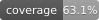

# SmartVision AI

Real-time spatial perception and object detection web application built with Django, TensorFlow/Keras, MiDaS, and Three.js.

The system performs multi-scale object detection across 10 classes, temporal multi-object tracking via Kalman filtering, 2D-to-3D metric spatial fusion using camera intrinsics, and multimodal scene reasoning.

---

## Key Features

- **Custom YOLO Detection**: 7.9M parameter CSPDarknet + FPN network with vectorized NumPy post-processing (6.3ms / ~156 FPS).
- **SORT Multi-Object Tracking**: 7-state Kalman filter box tracking with continuous velocity estimation and bipartite IoU matching.
- **RGB-D Metric 3D Fusion**: Pinhole camera intrinsic back-projection fusing 2D boxes with MiDaS monocular depth maps to compute metric 3D positions $(X, Y, Z)$ and Euclidean distances.
- **Spatial Scene Graph**: Semantic relation graph $\mathcal{G} = (\mathcal{V}, \mathcal{E})$ computing spatial interactions (`adjacent_to`, `interacting_with`) for contextual AI reasoning.
- **Asynchronous Telemetry Buffer**: Thread-safe write-behind buffer batching detection history to prevent request thread blocking.
- **Offline / Sandbox Resilience**: Fully functional offline perception engine with zero hard failures when cloud services are unreachable.
- **Interactive 3D Visualizer**: Three.js WebGL point cloud and mesh viewer with OrbitControls.

---

## Quickstart

### Option 1: Docker (Recommended for Evaluation)

Run the full application in a container with a single command:

```bash
docker compose up --build
```

Access the application at `http://localhost:8000`.

---

### Option 2: Local Python Setup

**Prerequisites**: Python 3.12

```bash
# Clone the repository
git clone https://github.com/Lamsalyusu/smart-vision-ai.git
cd smart-vision-ai

# Create and activate virtual environment
python3.12 -m venv .venv
source .venv/bin/activate        # On Windows: .venv\Scripts\activate

# Install dependencies
pip install -r requirements.txt

# Start development server
python manage.py migrate
python manage.py runserver
```

Open `http://127.0.0.1:8000` in your browser.

---

## Developer Commands (Makefile)

Standardized development and evaluation commands:

```bash
make test        # Run unit test suite (33 tests)
make coverage    # Run tests and generate coverage report
make benchmark   # Run latency percentiles and throughput profiler
make run         # Start Django development server
make docker-up   # Build and start Docker container
make docker-down # Stop Docker container
```

---

## Testing & Benchmarks

The repository includes test suites covering coordinate transformations, Kalman state transitions, spatial metric estimation, scene graph generation, and batch telemetry buffering.

```bash
# Run tests
python manage.py test

# Run latency benchmark
python model_evaluation/benchmark_pipeline.py
```

### Verified Benchmark Results

| Module | Mean Latency | P50 Latency | P95 Latency | Throughput |
| :--- | :--- | :--- | :--- | :--- |
| **Vectorized Post-Processing** | 6.38 ms | 6.14 ms | 6.93 ms | ~156 FPS |
| **SORT Kalman Tracker** | 0.06 ms | 0.06 ms | 0.07 ms | >16,000 FPS |
| **2D-to-3D Metric Fusion** | 0.15 ms | 0.15 ms | 0.17 ms | >6,500 FPS |

---

## Environment Configuration

Copy the example environment file:

```bash
cp .env.example .env
```

| Variable | Description | Default |
| :--- | :--- | :--- |
| `SECRET_KEY` | Django secret key | Built-in dev fallback |
| `DJANGO_DEBUG` | Enable debug mode | `True` |
| `OFFLINE_MODE` | Use local fallback for database & LLM | `False` |
| `SUPABASE_URL` | Supabase PostgreSQL project URL | Optional |
| `SUPABASE_SERVICE_ROLE_KEY` | Supabase administrative key | Optional |
| `GROQ_API_KEY` | Groq Llama 3 API key | Optional |

---

## License & Attribution

- **Project License**: MIT License (see [LICENSE](file:///home/yuyutsu/Desktop/smart-vision-ai/LICENSE))
- **Third-Party Disclosures**: See [THIRD_PARTY_LICENSES.md](file:///home/yuyutsu/Desktop/smart-vision-ai/THIRD_PARTY_LICENSES.md) for full licensing information regarding dataset sources (Roboflow Universe) and dependencies (Intel MiDaS, Three.js).



